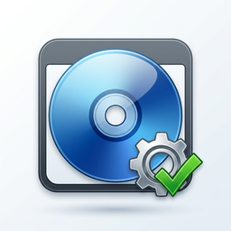

<p align="center">
  
</p>

<h1 align="center">Windows Customizer Studio</h1>

<p align="center">
  <a href="README.md">English</a> | <b>فارسی (Persian)</b>
</p>

<p align="center">
  یک پلتفرم حرفه‌ای و مرحله‌به‌مرحله برای سفارشی‌سازی ویندوز: از فایل ISO خام تا یک ISO نصب جدید،
  بوت‌پذیر و سفارشی‌شده — بدون اینکه کاربر با DISM، Registry یا XML دست‌وپنجه نرم کند.
</p>

```
ISO → Analyze → Customize → Validate → Build → Test → Final ISO
```

## وضعیت فعلی: نسخه کامل 1.0 ✅

تمام مراحل توسعه پیاده‌سازی شده‌اند — جزئیات در [`docs/Roadmap.md`](docs/Roadmap.md).

| بخش | قابلیت‌ها |
|-----|-----------|
| **پروژه** | Workspace استاندارد، فایل `.wcp`، Recent Projects، Snapshot/Rollback |
| **تحلیل ISO** | Volume Label، UDF/ISO9660، بوت BIOS/UEFI، install.wim/esd، هدر WIM، SHA-256 |
| **انتخاب ادیشن** | نمایش فوری ادیشن‌های داخل ISO از مانیفست WIM (بدون استخراج) در صفحهٔ Source ISO |
| **شخصی‌سازی** | Users/Computer/Language، Apps (Keep/Remove/Optional)، Drivers، Updates، Registry + Preset، Services، Features، Scripts، Branding، فایل‌ها، نرم‌افزارها |
| **Preset** | Privacy / Performance / Security / UI + Export/Import/Reset/Duplicate (Marketplace-ready) |
| **Safety** | Risk Level (Safe→Critical)، Dependency Engine، تأیید تغییرات Critical |
| **Review** | صفحه مرور همه تغییرات با Enable/Disable + هشدارها و رفع خودکار |
| **Build** | Pipeline کامل ۱۵ مرحله‌ای + گزارش MD/JSON + نمایش زنده مراحل |
| **ISO Builder** | oscdimg (BIOS+UEFI) + fallback مدیریتی، Autounattend.xml خودکار |
| **Validation** | بررسی پروژه و ISO خروجی (بوت، payload، ساختار) |
| **VM Test** | تشخیص Hyper-V/QEMU + راهنما |
| **Theme** | تم روشن ثابت، حالت‌های Basic/Advanced |

## شروع سریع

۱. فایل **`WindowsCustomizer.exe`** را از صفحهٔ [Releases](https://github.com/wrappedman/WindowsCustomizer/releases) دانلود کنید.
۲. روی **Windows 10/11** با نصب بودن [.NET 8 Desktop Runtime](https://dotnet.microsoft.com/download/dotnet/8.0) اجرا کنید.
۳. برنامه را با دسترسی Administrator اجرا کنید (برنامه سطح دسترسی را تشخیص می‌دهد و راهنمایی می‌کند).
۴. پروژه بسازید → ISO ویندوز را انتخاب کنید → سفارشی‌سازی کنید → **Build Customized ISO**.

## پیش‌نیازها

- **اجرای برنامه**: Windows 10/11 + [.NET 8 Desktop Runtime](https://dotnet.microsoft.com/download/dotnet/8.0)
- **بیلد از سورس**: .NET 8 SDK (روی ویندوز) — جزئیات در [`docs/Setup.md`](docs/Setup.md)

## بیلد سریع (ویندوز)

```powershell
dotnet build WindowsCustomizer.sln -c Release
dotnet test tests/WindowsCustomizer.Core.Tests -c Release
powershell -File scripts/build.ps1
```

خروجی تک‌فایل: `dist/win-x64/WindowsCustomizer.exe`

## بیلد لینوکس (Cross-Compile)

```bash
bash scripts/build.sh
```

## ساختار Solution

```
WindowsCustomizer/
├── src/
│   ├── WindowsCustomizer.Core/    # منطق دامنه (cross-platform): مدل‌ها، تحلیل ISO، لاگ، امنیت
│   └── WindowsCustomizer.App/     # رابط WPF (MVVM) — هرگز مستقیماً با DISM/File System کار نمی‌کند
├── tests/
│   └── WindowsCustomizer.Core.Tests/
├── docs/                          # مستندات (فارسی)
├── scripts/                       # اسکریپت‌های بیلد و انتشار
└── dist/                          # خروجی بیلد (gitignore)
```

## مستندات

| فایل | موضوع |
|------|-------|
| [docs/Architecture.md](docs/Architecture.md) | معماری، لایه‌ها، انتخاب تکنولوژی |
| [docs/Setup.md](docs/Setup.md) | نصب، بیلد، تست، انتشار |
| [docs/Roadmap.md](docs/Roadmap.md) | نقشه راه توسعه |
| [docs/phases/Phase-01.md](docs/phases/Phase-01.md) | گزارش کامل Phase 1 |

## اصل مهم

> این پروژه فقط یک GUI برای دستورهای DISM نیست؛ یک **Windows Customization Platform** با Engine مرکزی، Preset، Dependency Engine، Safety System و Validation است. عملیات حساس لاگ، اعتبارسنجی و بازگشت‌پذیر می‌شوند؛ خطاها همیشه می‌گویند چه شد، چرا، و چه باید کرد.

## نویسنده

**Behnam Ehsani** — [github.com/wrappedman](https://github.com/wrappedman) · inbox.ehsani@gmail.com
