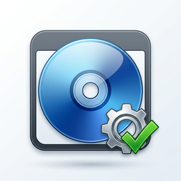

<p align="center">
  
</p>

<h1 align="center">Windows Customizer Studio</h1>

<p align="center">
  <b>English</b> | <a href="README.fa.md">فارسی (Persian)</a>
</p>

<p align="center">
  A modern, step-by-step Windows image customization platform — from a stock Windows ISO to a
  new, bootable, personalized installer without ever touching DISM, the registry, or unattend XML.
</p>

```
ISO → Analyze → Customize → Validate → Build → Test → Final ISO
```

## Status: version 1.0 complete ✅

The full pipeline is implemented — see [`docs/Roadmap.md`](docs/Roadmap.md) for details.

| Area | Capabilities |
|------|--------------|
| **Project** | Standard workspace, `.wcp` project file, Recent Projects, Snapshot/Rollback |
| **ISO Analysis** | Volume label, UDF/ISO9660, BIOS/UEFI boot files, install.wim/esd, WIM header, SHA-256 |
| **Edition picker** | Instant edition list from the WIM XML manifest inside the ISO (no extraction) on the Source ISO page |
| **Customization** | Users/Computer/Language, Apps (keep/remove/optional), Drivers, Updates, Registry + presets, Services, Features, Scripts, Branding, custom files, app packages (silent installers) |
| **Presets** | Privacy / Performance / Security / UI + Export/Import/Reset/Duplicate (marketplace-ready) |
| **Safety** | Risk levels (Safe→Critical), Dependency Engine, confirmation for critical changes |
| **Review** | Review page with every change toggleable (enable/disable) + warnings and auto-fix |
| **Build** | Full 15-step pipeline + MD/JSON report, live step progress |
| **ISO Builder** | oscdimg (BIOS+UEFI) with managed fallback, automatic Autounattend.xml |
| **Validation** | Validates the project and the output ISO (boot files, payload, structure) |
| **VM Test** | Hyper-V/QEMU detection + guided smoke-test |
| **Theme** | Fixed light theme, Basic/Advanced modes |

## Getting started

1. Download **`WindowsCustomizer.exe`** from the [Releases](https://github.com/wrappedman/WindowsCustomizer/releases) page.
2. Run it on **Windows 10/11** with the [.NET 8 Desktop Runtime](https://dotnet.microsoft.com/download/dotnet/8.0) installed.
3. Run as Administrator (the app detects elevation and tells you what needs it).
4. Create a project → pick your Windows ISO → customize → **Build Customized ISO**.

## Build from source

### Windows (quick)

```powershell
dotnet build WindowsCustomizer.sln -c Release
dotnet test tests/WindowsCustomizer.Core.Tests -c Release
powershell -File scripts/build.ps1
```

Single-file output: `dist/win-x64/WindowsCustomizer.exe`

### Linux (cross-compile)

```bash
bash scripts/build.sh
```

## Solution structure

```
WindowsCustomizer/
├── src/
│   ├── WindowsCustomizer.Core/    # Domain logic (cross-platform): models, ISO analysis, logging, security
│   └── WindowsCustomizer.App/     # WPF UI (MVVM) — never talks to DISM/the file system directly
├── tests/
│   └── WindowsCustomizer.Core.Tests/
├── docs/                          # Documentation (Persian)
├── scripts/                       # Build & release scripts
└── dist/                          # Build output (gitignored)
```

## Documentation

| File | Topic |
|------|-------|
| [docs/Architecture.md](docs/Architecture.md) | Architecture, layers, technology choices |
| [docs/Setup.md](docs/Setup.md) | Install, build, test, release |
| [docs/Roadmap.md](docs/Roadmap.md) | Development roadmap |
| [docs/phases/Phase-01.md](docs/phases/Phase-01.md) | Full Phase 1 report |

## Design principle

> This is not just a GUI over DISM commands — it is a **Windows customization platform** with a
> central engine, presets, a dependency engine, a safety system, and validation. Sensitive
> operations are logged, validated, and reversible; errors explain what happened, why, and what to do.

## Author

**Behnam Ehsani** — [github.com/wrappedman](https://github.com/wrappedman) · inbox.ehsani@gmail.com
